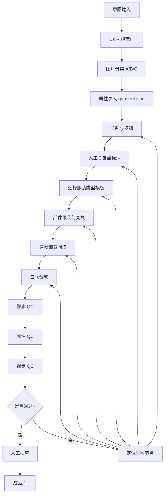

# 服装平面图半自动工作流方案

日期：2026-10-10

## 1. 目标

把现有服装照片转换成统一规格的服装平面图，同时尽量保留真实工艺细节，避免整图 AI 重绘造成的细节漂移。

目标输出：

- 尺寸：`1536 × 1536`
- 背景：纯白
- 主体：完整、居中、不裁切
- 单件：衣服平铺，袖子或下摆自然展开
- 套装：上衣和裤子分开完整呈现，再合成统一构图
- 细节：扣子、口袋、缝线、领型、袖口、内衬、腰头等以原图和商品属性为准

本方案的核心不是“一键 AI 改图”，而是：

```text
图片分类
-> 结构化属性
-> 分割
-> 人工关键点
-> 部件级模板变换
-> 原图细节回填
-> 白底合成
-> 节点 QC
-> 人工确认
```

AI 可以辅助识别和 QC，但不作为最终像素的唯一生成者。

## 2. 基本原则

1. **原图不可修改**
   - 原始照片只读取，不直接覆盖。
   - 所有中间结果和成品分开保存。

2. **属性优先于视觉猜测**
   - 扣子数量、口袋数量、缝线数量、内衬等信息优先来自人工录入或商品资料。
   - 视觉模型只能生成建议，人工确认后才能作为 QC 依据。

3. **不同衣服走不同模板**
   - 上衣、外套、裤子、裙装、套装、毛织品不能共用同一条几何链路。

4. **部件级处理**
   - 不把整件衣服直接拉伸到模板上。
   - 先拆成衣身、袖子、领子、腰头、裤腿等部件，再分别映射。

5. **细节来自原图**
   - 扣子、条纹、格子、拉链、袋口、腰头双缝线尽量从原图裁切回填。
   - 原图没有的信息不凭空生成，标记为缺失并进入补拍或人工处理。

6. **失败可定位**
   - 每一步都有输入、输出、状态和 QC 结果。
   - 哪一步失败，只重跑那一步，不盲目重做整张图。

## 3. 输入分类

处理前，每张图先分为 A / B / C 三类。

| 类型 | 定义 | 处理策略 |
| --- | --- | --- |
| A 类 | 已平铺、白底、人台正面、结构完整 | 自动抠图、校色、白底、居中、尺寸统一 |
| B 类 | 穿搭图或挂拍图，但衣服轮廓和部件清楚 | 人工选模板、标关键点，系统做部件级几何变换 |
| C 类 | 遮挡严重、细节缺失、套装不完整、图片模糊 | 补拍、补细节图、补工艺数据，或转人工修图 |

不要强迫 C 类图片走自动流程。C 类图缺少的信息无法通过纯算法恢复。

## 4. 商品属性结构

每件衣服生成一个 `garment.json`，作为提示词、模板选择和 QC 的共同依据。

示例：

```json
{
  "id": 172,
  "source": "work_library/IMG_1113.HEIC",
  "type": "shirt",
  "pieces": 1,
  "color": "white with black vertical stripes",
  "pattern": {
    "type": "vertical stripe",
    "direction": "vertical",
    "spacing": "regular"
  },
  "buttons": 5,
  "collar": "wide pointed collar",
  "sleeves": "long sleeves with buttoned cuffs",
  "pockets": [],
  "seams": ["shoulder", "side", "cuff"],
  "hem": "two tie details",
  "lining": false,
  "fabric": "lightweight woven",
  "must_preserve": [
    "stripe direction",
    "stripe spacing",
    "five buttons",
    "buttoned cuffs",
    "hem ties"
  ]
}
```

### 常见类型字段

#### 上衣

- 领型
- 门襟方式
- 扣子数量和位置
- 袖长
- 袖口形态
- 肩线
- 口袋
- 下摆
- 内衬

#### 外套

- 翻领
- 前片开合
- 内衬颜色和可见区域
- 口袋
- 袖口
- 扣子或拉链
- 缝线

#### 裤子

- 腰头高度
- 门襟
- 串带数量
- 腰头缝线数量
- 口袋类型和位置
- 裤腿宽度
- 锥度
- 脚口形态

#### 套装

- 上衣和裤子的件数
- 每件的颜色和面料
- 上衣细节
- 裤子细节
- 是否存在配套辅料

## 5. 主流程



## 6. 节点设计

### 6.1 输入规范化

输入：

- 原图路径
- SKU 或编号

处理：

- 读取 EXIF
- 自动转正
- 色彩初步校正
- 生成稳定尺寸的工作图

输出：

```text
00-input.jpg
01-normalized.jpg
```

### 6.2 图片分类

判断：

- 是否已经平铺
- 是否白底
- 是否人体穿着
- 是否挂拍
- 是否遮挡
- 是否套装
- 是否模糊

输出：

```json
{
  "class": "B",
  "garment_type": "shirt",
  "capture_state": "hanging",
  "occlusion": "low",
  "detail_quality": "good",
  "confidence": "high"
}
```

### 6.3 属性录入

来源优先级：

1. 人工录入
2. 商品资料或工艺单
3. 视觉模型建议
4. 原图细节 crop

视觉模型生成的字段必须标记来源：

```json
{
  "buttons": {
    "value": 5,
    "source": "human_confirmed"
  }
}
```

### 6.4 分割

可用工具：

- Rembg
- SAM / SAM2
- 人工 mask
- 传统边缘分割辅助

QC 内容：

- 是否残留背景
- 是否缺袖子
- 是否缺裤腿
- 是否把人体一起保留
- 是否误删薄纱或毛发区域

输出：

```text
02-segmentation.png
```

### 6.5 人工关键点

#### 上衣关键点

```text
颈左点
颈右点
左肩点
右肩点
左袖窿
右袖窿
左袖口内点
左袖口外点
右袖口内点
右袖口外点
左侧缝上点
左侧缝下点
右侧缝上点
右侧缝下点
下摆左点
下摆中点
下摆右点
```

#### 裤子关键点

```text
腰头左点
腰头中点
腰头右点
门襟上点
门襟下点
左口袋上点
左口袋下点
右口袋上点
右口袋下点
左侧缝上点
左侧缝下点
右侧缝上点
右侧缝下点
左脚口外点
左脚口内点
右脚口内点
右脚口外点
```

关键点保存在：

```text
05-landmarks.json
```

### 6.6 模板库

首批建议只做 6 类：

1. 长袖上衣
2. 短袖上衣
3. 开襟外套
4. 长裤
5. 连衣裙或半身裙
6. 两件套

每个模板包含：

- 目标画布比例
- 衣身目标区域
- 左右袖目标区域
- 领子目标区域
- 下摆目标区域
- 腰头和裤腿目标区域
- 四边留白规则

### 6.7 部件级几何变换

不要整图直接 warp。

上衣拆分：

```text
衣身
左袖
右袖
领子
下摆
```

裤子拆分：

```text
腰头
门襟
左裤腿
右裤腿
左口袋
右口袋
```

可选算法：

- 分段透视变换
- Thin Plate Spline
- 分段 homography
- 网格变形
- 左右对称约束
- 尺寸比例锁定

### 6.8 原图细节回填

需要回填的内容：

- 扣子
- 扣眼
- 条纹
- 格子
- 拉链
- 袋口
- 腰头双缝线
- 袖口
- 领子
- 内衬
- 标签

处理方式：

1. 从原图裁切局部高清区域。
2. 对齐到模板坐标。
3. 只允许轻微透视校正。
4. 不改变颜色、数量、间距和形状。
5. 无法从原图确认的信息标记为缺失。

### 6.9 白底合成

统一规则：

- 输出尺寸 `1536 × 1536`
- 背景纯白
- 四边留白均匀
- 单件居中
- 套装各件完整
- 不裁切关键结构
- 不添加额外阴影，除非模板明确要求轻微接触阴影

## 7. 目录结构

每个编号一个独立运行目录：

```text
plan_workflow_runs/172/
  00-input.jpg
  01-normalized.jpg
  02-segmentation.png
  03-garment.json
  04-classification.json
  05-landmarks.json
  06-template.png
  07-warped/
    body.png
    left-sleeve.png
    right-sleeve.png
    collar.png
    hem.png
  08-detail/
    buttons.png
    collar.png
    cuffs.png
    hem.png
    stripes.png
  09-composite.png
  10-final.png
  11-qc.json
  state.json
```

正式成品只复制到：

```text
work_library_plan_view/
```

原始图片库：

```text
work_library/
```

## 8. 状态设计

每个节点有状态：

```json
{
  "id": 172,
  "nodes": {
    "normalize": "passed",
    "classify": "passed",
    "attributes": "passed",
    "segment": "passed",
    "landmarks": "failed",
    "template": "pending",
    "warp": "pending",
    "detail": "pending",
    "compose": "pending",
    "qc": "pending"
  },
  "retry": {
    "landmarks": 1
  }
}
```

状态：

- `pending`
- `running`
- `passed`
- `failed`
- `needs_human`
- `blocked`

## 9. QC 体系

### 9.1 像素 QC

检查：

- 尺寸是否 `1536 × 1536`
- 边缘是否纯白
- 主体是否居中
- 主体是否被裁切
- 留白是否均匀
- 前景覆盖率是否合理
- 是否有明显背景残留

### 9.2 属性 QC

对照 `garment.json`：

- 扣子数量是否正确
- 口袋数量和位置是否正确
- 缝线数量是否正确
- 领型是否正确
- 袖口是否正确
- 内衬是否保留
- 裤腰双缝线是否保留
- 条纹方向是否正确
- 条纹间距是否明显漂移

### 9.3 视觉 QC

检查：

- 是否有平铺感
- 是否仍像挂拍或穿搭图
- 左右是否对称
- 袖子是否自然
- 裤腿是否变形
- 套装是否互相融合
- 是否出现拼贴感
- 是否出现插画化或动画化

### 9.4 人工抽查

自动 QC 通过后，人工抽查：

- A 类：抽查 5% 到 10%
- B 类：抽查 20% 到 50%
- C 类：必须逐张检查

## 10. 失败重跑规则

| 问题 | 重跑节点 |
| --- | --- |
| 背景残留 | 分割或白底合成 |
| 缺袖子 | 分割、关键点、部件变换 |
| 左右不对称 | 关键点、模板映射 |
| 衣身变形 | 部件级几何变换 |
| 扣子数量错 | 属性录入或细节回填 |
| 缝线丢失 | 细节 crop 或细节回填 |
| 条纹方向错 | 属性录入、几何变换 |
| 套装融合 | 分类、模板、部件拆分 |
| 裁切 | 白底合成 |
| 平铺感不足 | 模板选择或几何变换 |

## 11. AI 使用边界

### 允许

- 辅助分类
- 辅助识别衣服类型
- 生成 `garment.json` 草稿
- 给 QC 建议
- 辅助定位错误
- 生成低质量预览，用于确认方向

### 不允许

- 直接把 AI 生成图当成最终成品
- 自由重画扣子、缝线、内衬
- 在 C 类图上猜测缺失结构
- 未人工确认就写入正式成品库

原则：

```text
AI 可以建议，不能决定。
```

## 12. 后续拍摄规范

以后新增衣服，优先标准拍摄，而不是依赖后期转换。

### 拍摄要求

- 相机垂直俯拍
- 背景纯白或浅灰
- 灯光均匀
- 衣服熨烫后平铺
- 袖子自然摊开
- 裤腿拉直
- 上衣和裤子分开拍摄
- 套装每件单独拍，再拍合影

### 必拍细节

```text
正面平铺
背面平铺
领子
扣子
口袋
腰头
缝线
袖口
内衬
面料纹理
```

标准输入越规范，自动化率越高。

## 13. 实施阶段

### 第一阶段：整理存量图

1. 建立编号和原图映射表。
2. SHA-256 去重。
3. 分成 A / B / C。
4. A 类先自动白底和尺寸规范化。

### 第二阶段：模板库

先做 6 类模板：

```text
长袖上衣
短袖上衣
开襟外套
长裤
连衣裙或半身裙
两件套
```

### 第三阶段：标注界面

功能：

1. 选择服装类型。
2. 显示原图。
3. 点关键点。
4. 确认或修正 `garment.json`。
5. 查看当前节点结果。

### 第四阶段：部件级变换

先支持：

1. 上衣衣身
2. 左袖
3. 右袖
4. 领子
5. 裤子腰头
6. 左右裤腿

### 第五阶段：QC 与重跑

实现：

- 像素 QC
- 属性 QC
- 视觉 QC 建议
- 节点级失败报告
- 单节点重跑

### 第六阶段：试点

选择 20 张：

```text
A 类 5 张
B 类 10 张
C 类 5 张
```

验收标准：

- A 类基本全自动
- B 类在关键点确认后稳定输出
- C 类明确提示补拍或人工处理
- 成品不与原图和属性数据冲突

## 14. 与当前项目的关系

当前原图库：

```text
work_library/
```

当前成品库：

```text
work_library_plan_view/
```

当前编号映射：

```text
work_library/final_plan_view_mapping.csv
```

现有云端两阶段脚本可作为参考实现：

```text
py/batch_final_plan_views.py
```

后续应新增独立工作流脚本，例如：

```text
py/plan_view_workflow.py
```

不要直接改造现有成品流程到不可回滚状态。新流程应先在独立目录试运行，验证质量后再接入正式成品库。

## 15. 最终结论

推荐采用：

```text
结构化数据
+ 图片分类
+ 人工关键点
+ 类型模板
+ 部件级几何变换
+ 原图细节回填
+ 节点 QC
+ 人工确认
```

这条路线比整图 AI 生成更可控，也更接近企业实际生产方式。它不承诺从单张信息不足的照片中凭空恢复缺失细节，而是把能自动化的部分自动化，把信息不足的部分明确交给补拍、补数据或人工处理。
